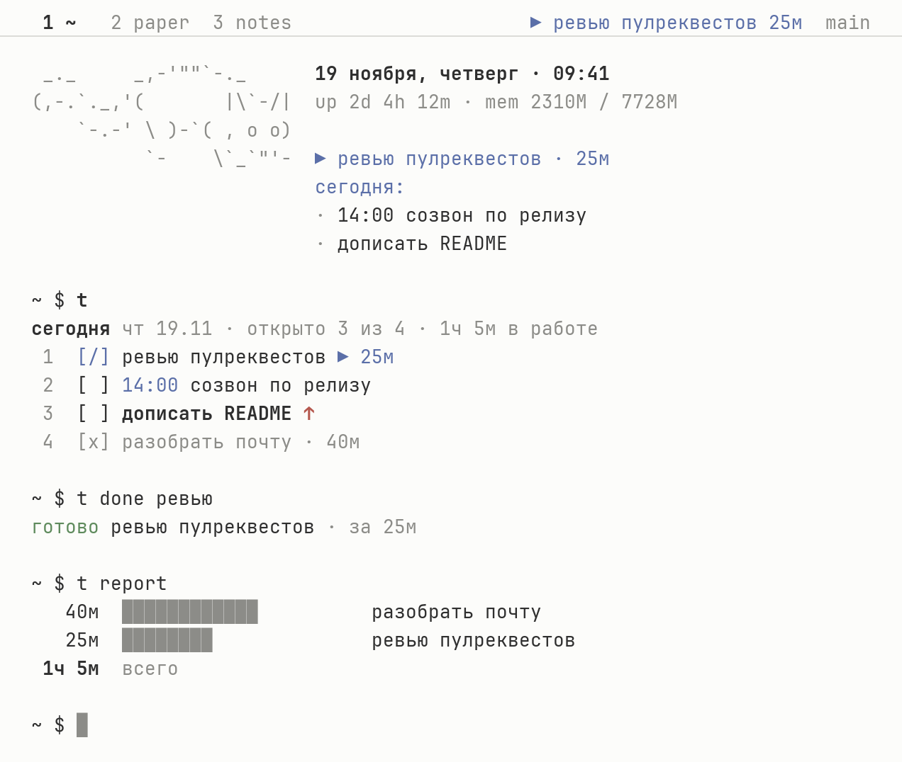
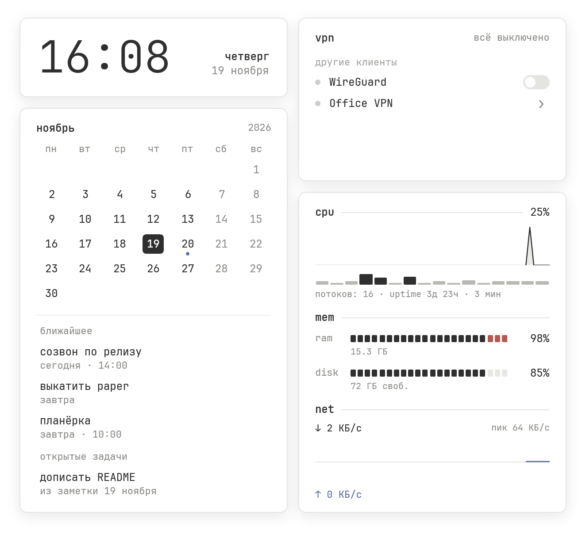
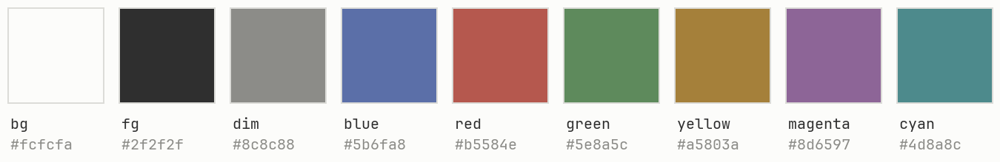

<pre>
 _._     _,-'""`-._        paper
(,-.`._,'(       |\`-/|    
    `-.-' \ )-`( , o o)    мягкий бумажный сетап для windows + wsl
          `-    \`_`"'-    терминал · задачи · виджеты · одна палитра
</pre>

светлый фон, графитовый текст, приглушённые цвета, JetBrains Mono везде.
задачи живут в заметках дня Obsidian, а управляются из терминала.

<p align="center"></p>

---

## что внутри

| | |
|---|---|
| **`t`** | задачи и заметки Obsidian из терминала: статусы, учёт времени, лог дня, перенос, поиск |
| **сводка** | кот, дата, аптайм и задачи на сегодня — в каждой новой вкладке tmux и при открытии терминала |
| **tmux** | вкладки и панели на `Alt` без префикса, работает и в русской раскладке |
| **keys** | шпаргалка по всем клавишам — командой `keys` или `F1` прямо в tmux |
| **alacritty** | бумажная палитра, блочный курсор, `Ctrl+V` / `Ctrl+Shift+C`, кириллица в хоткеях |
| **mini** | промпт `dir $ ` для oh-my-zsh, без ничего лишнего |
| **виджеты** | часы, календарь с задачами, VPN, графики cpu/mem/net, напоминания Windows за 15 минут |
| **obsidian · vs code** | сниппет и цвета в той же палитре (у vs code есть тёмная версия) |
| **обои** | конвертер фото → ASCII ровно под разрешение монитора |

<p align="center"></p>

## установка

**wsl / linux** — нужны `zsh`, `tmux`, `python3`:

```sh
git clone <этот репо> ~/paper && bash ~/paper/install.sh
$EDITOR ~/.config/paper/config      # путь к волту и папки заметок
t config && t help
```

**windows** — PowerShell, без прав администратора:

```powershell
.\install.ps1                                            # alacritty + шрифт
.\install.ps1 -Vault "$env:USERPROFILE\Documents\vault"  # + сниппет obsidian
.\install.ps1 -Widgets                                   # + виджеты в автозагрузку
```

оба установщика можно гонять повторно: свои файлы обновляют, чужие уносят в `*.bak-<дата>`,
твой конфиг и арт не трогают.

<pre>
("`-''-/").___..--''"`-._
 `6_ 6  )   `-.  (     ).`-.__.`)
 (_Y_.)'  ._   )  `._ `. ``-..-'
   _..`--'_..-_/  /--'_.'
  ((((.-''  ((((.'  (((.-'
</pre>

## t

```
t                     сегодня              t start форм  [/] пошёл таймер
t tom · t +3 · t week другие дни           t pause       пауза, время копится
t add 16:00 текст     со временем          t done        [x] готово · за 1ч 10м
t add @tom текст      на другой день       t now         что тикает прямо сейчас
t rollover            вчерашнее на сегодня t report      куда ушло время за день
t prio 2 · t at 2 -   приоритет · время    t mv 3 [день] [>] перенести
t find слово          поиск по волту       t help        всё остальное
```

заметки пишутся в ту же заметку дня: `t note текст` — в `## Notes`, `t log текст` — в `## Work log` с временем,
`t notes` показывает всё за день. заголовки разделов настраиваются в конфиге.

задачу можно указать номером, куском текста (`t start форм`) или не указывать вовсе — тогда выбор через fzf.
в работе всегда одна задача: старт новой ставит прошлую на паузу. таймер виден справа в строке tmux
и в сводке, а итог пишется прямо в заметку — `[spent:: 1h 10m] ✅ 2026-11-19`, это понимает Dataview.

статусы — как в плагине Obsidian Tasks, так что заметки остаются обычным markdown.
задача со временем (`t add 16:00 …`) даёт уведомление Windows за 15 минут, если запущены виджеты.

## настройка

всё в `~/.config/paper/config` (пример — [`config.example`](config.example)):

```sh
VAULT="/mnt/c/Users/YOU/Documents/vault"   # волт, как его видно из wsl
DAILY_DIR="daily"                          # папка заметок дня
DAILY_TEMPLATE="templates/daily.md"        # шаблон для новых заметок
ART="$HOME/.config/paper/art.txt"          # любой текстовый арт для сводки
GREET_TASKS=3                              # сколько задач показывать
POPUP=1                                    # сводка при открытии терминала
```

в [`art/`](art) лежат ещё варианты (кот, пума, длинный кот, терминал) — просто скопируй любой в `~/.config/paper/art.txt`.

виджеты читают `widgets.config.json` рядом с собой: волт, клиенты VPN, за сколько минут напоминать
([пример](windows/widgets/widgets.config.example.json)).

## палитра

<p align="center"></p>

одна палитра на всё: alacritty, tmux, zsh, fzf, виджеты, obsidian, vs code.

## обои

```sh
python tools/ascii_photo.py фото.jpg обои.png 1920 1080 13 JetBrainsMono-Bold.ttf [ширина_полосы_слева]
```

рендерь ровно в разрешение монитора — тогда символы чёткие. тёмные места заливаются фактурой
из `@ # % & $`, тонкие линии — штрихами `/ \ | -`.

## удалить

`~/.local/bin/{t,term-start}`, `~/.config/{paper,zsh/greet.zsh}`, блок `>>> paper >>>` в `~/.zshrc`,
`~/.tmux.conf` — а рядом лежат `*.bak-*`, если хочешь вернуть как было.

<pre>
           __..--''``---....___   _..._    __
 /// //_.-'    .-/";  `        ``&lt;._  ``.''_ `. / // /
///_.-' _..--.'_    \                    `( ) ) // //
/ (_..-' // (&lt; _     ;_..__               ; `' / ///
 / // // //  `-._,_)' // / ``--...____..-' /// / //
</pre>

<sub>MIT · сделано для себя, валяется для всех · ASCII-арт котов — <a href="https://www.asciiart.eu/animals/cats">asciiart.eu</a>, художники неизвестны (см. <a href="art/CREDITS.md">art/CREDITS.md</a>)</sub>
